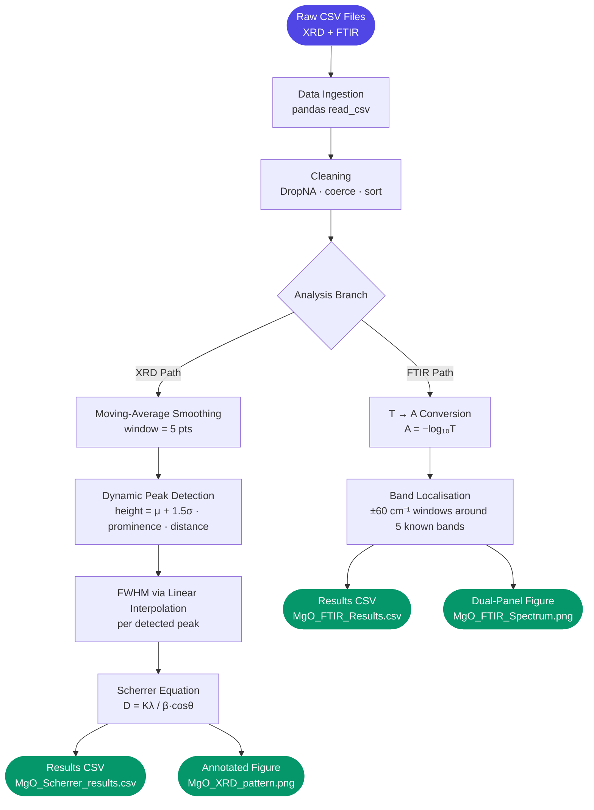

# MgO Nanoparticle Characterization Pipeline


> An end-to-end Python pipeline that ingests raw XRD and FTIR instrument data for MgO nanoparticles, performs signal processing and peak analysis, and exports publication-ready figures and structured result tables — no manual curve fitting required.

---

## Table of Contents

- [The Problem](#the-problem)
- [What This Does](#what-this-does)
- [Why Not Just Use Origin or HighScore?](#why-not-just-use-origin-or-highscore)
- [Tech Stack](#tech-stack)
- [Processing Pipeline](#processing-pipeline)
- [File Structure](#file-structure)
- [Prerequisites](#prerequisites)
- [Installation & Setup](#installation--setup)
- [Running the Analysis](#running-the-analysis)
- [Output Files](#output-files)
- [Configuration & Tuning](#configuration--tuning)
- [Known Limitations & Roadmap](#known-limitations--roadmap)
---

## The Problem

Characterization data from XRD diffractometers and FTIR spectrometers is delivered as raw numeric CSV exports — noisy, unprocessed, and requiring domain-specific transformations before any meaningful conclusion can be drawn. Standard workflows demand:

- Manual baseline subtraction and smoothing in proprietary software
- Hand-identification of Bragg diffraction peaks across potentially hundreds of data points
- Manual application of Scherrer's equation for each detected peak individually
- Separate software for FTIR transmittance-to-absorbance conversion and band assignment

This creates friction, reproducibility issues, and significant time cost when the same analysis needs to be re-run on new batches or slightly different datasets.

**Core pain points this addresses:**

- No single script that handles both XRD structural analysis and FTIR spectroscopic analysis in one run
- Crystallite size calculations (Scherrer equation) done manually per peak, error-prone and time-consuming
- FTIR band assignments require domain knowledge applied repeatedly for every new sample
- Output figures require additional formatting before they are publication-ready

---

## What This Does

`MgO_Nanoparticle_Characterization.py` is a self-contained analytical pipeline for processing raw MgO nanoparticle characterization data. Given two CSV input files from XRD and FTIR instruments, it delivers annotated spectral plots and a structured quantification table without manual intervention.

It achieves this by:

1. **Automated signal conditioning** — applies moving-average convolution to suppress baseline noise before peak detection, using a configurable window size
2. **Dynamic peak detection** — identifies Bragg diffraction peaks using adaptive height thresholding (mean + 1.5σ) combined with prominence and minimum-separation filters, eliminating false positives from noise
3. **Scherrer crystallite sizing** — computes FWHM via linear interpolation across half-maximum crossings for each detected peak, then applies `D = (Kλ) / (β·cosθ)` using Cu Kα radiation (λ = 0.15406 nm)
4. **FTIR spectral transformation** — converts raw transmittance to absorbance via Beer-Lambert's law (`A = −log₁₀T`), then locates the five characteristic MgO absorption bands within configurable search windows
5. **Structured export** — saves annotated PNG figures at 150 DPI and results as CSV tables ready for direct inclusion in reports

---

## Why Not Just Use Origin or HighScore?

| Capability | This Pipeline | HighScore+ | OriginPro |
|---|:---:|:---:|:---:|
| Fully open-source, no license cost | ✅ | ❌ | ❌ |
| Handles both XRD and FTIR in one script | ✅ | ❌ | ✅ |
| Automated Scherrer sizing (no manual FWHM) | ✅ | ❌ | ❌ |
| Reproducible — same input, same output, always | ✅ | ❌ | ❌ |
| Configurable thresholds without a GUI | ✅ | ❌ | ❌ |
| Exports structured CSV results alongside figures | ✅ | ✅ | ✅ |
| Runs on any OS with Python 3.8+ | ✅ | ❌ | ❌ |

> **Bottom line:** Unlike GUI-based tools, this pipeline is scriptable, version-controllable, and produces identical results every time — making it suited for academic workflows where reproducibility matters.

---

## Tech Stack

| Library | Version | Role in Pipeline |
|---|---|---|
| Python | 3.8+ | Runtime |
| NumPy | ≥1.21 | Array operations, convolution, Scherrer arithmetic |
| pandas | ≥1.3 | CSV ingestion, data cleaning, results export |
| matplotlib | ≥3.4 | Annotated spectral figure generation |

> No scipy dependency. Peak detection is implemented natively in NumPy (`find_peaks_numpy`) to keep the dependency footprint minimal.

---

## Processing Pipeline



### Stage-by-Stage Breakdown

| Stage | What Happens |
|---|---|
| **Ingestion** | Both CSV files are read with `pd.read_csv`; columns are coerced to numeric and rows with NaN values are dropped |
| **Smoothing (XRD)** | A 5-point moving average via `np.convolve` reduces noise before peak detection without distorting peak positions |
| **Peak Detection** | Candidate peaks must exceed a dynamic height threshold (`mean + 1.5·std`), have prominence ≥ 30 counts, and be separated by ≥ 50 data points |
| **FWHM Calculation** | For each peak, a ±80-point window is extracted; the half-maximum crossing angles are found by linear interpolation; FWHM = right crossing − left crossing |
| **Scherrer Sizing** | `D = (0.9 × 0.15406 nm) / (β_rad × cos(θ_rad))` applied per peak; results averaged |
| **T→A (FTIR)** | Transmittance normalised to [0,1] if in percent; `A = −log₁₀(T)` applied element-wise |
| **Band Assignment** | Five reference bands queried in ±60 cm⁻¹ windows; minimum-transmittance point within each window reported |
| **Export** | Figures saved at 150 DPI; results written to CSV with rounded numeric precision |

---

## File Structure

```
MgO-Nanoparticle-Characterization/
│
├── MgO_Nanoparticle_Characterization.py   # Complete analytical pipeline (XRD + FTIR)
│
├── MgO_XRD_sample.csv                     # Raw XRD input — columns: 2Theta, Intensity
├── MgO_FTIR_digitized.csv                 # Raw FTIR input — columns: Wavenumber, Transmittance
│
├── MgO_XRD_pattern.png                    # Generated: annotated XRD diffraction pattern
├── MgO_FTIR_Spectrum.png                  # Generated: dual-panel FTIR spectrum (T and A)
│
├── MgO_Scherrer_results.csv               # Generated: per-peak FWHM and crystallite size table
├── MgO_FTIR_Results.csv                   # Generated: FTIR band assignment and absorbance table
│
└── README.md
```

> The three generated files (`*.png`, `MgO_Scherrer_results.csv`, `MgO_FTIR_Results.csv`) are created at runtime in the same directory as the script. They are committed here as reference outputs from a sample run.

---

## Prerequisites

| Requirement | Minimum Version | Check Command |
|---|---|---|
| Python | 3.8 | `python --version` |
| pip | 21.x | `pip --version` |
| NumPy | 1.21 | `python -c "import numpy; print(numpy.__version__)"` |
| pandas | 1.3 | `python -c "import pandas; print(pandas.__version__)"` |
| matplotlib | 3.4 | `python -c "import matplotlib; print(matplotlib.__version__)"` |

**OS compatibility:** Tested on Windows 11 and macOS. The FTIR section uses hardcoded Windows path separators (`\`) in the original — see [Configuration & Tuning](#configuration--tuning) for cross-platform path setup.

---

## Installation & Setup

### 1. Clone the repository

```bash
git clone https://github.com/sadagopan246/MgO-Nanoparticle-Characterization.git
cd MgO-Nanoparticle-Characterization
```

### 2. Install dependencies

```bash
pip install numpy pandas matplotlib
```

No virtual environment is required, but one is recommended for clean dependency management:

```bash
python -m venv venv
source venv/bin/activate        # macOS/Linux
venv\Scripts\activate           # Windows
pip install numpy pandas matplotlib
```

### 3. Place input files

Ensure both raw CSV files are in the same directory as the script:

```
MgO_XRD_sample.csv
MgO_FTIR_digitized.csv
```

Both files are already included in this repository as sample data.

---

## Running the Analysis

```bash
python MgO_Nanoparticle_Characterization.py
```

The script runs the XRD analysis first (Steps 1–10), then the FTIR analysis (Steps 1–9). Both sections print progress and results to the terminal as they run.

**Expected terminal output (abbreviated):**

```
First 5 rows of the data: ...
Data loaded: XXXX data points
2-theta range: 20.00° to 80.00°

Number of peaks detected: N
Detected peak positions (2θ): [...]

==========================================================================
        Scherrer Crystallite Size Results for MgO Nanoparticles
==========================================================================
 Peak #  2θ (deg)  Intensity  FWHM (deg)  ...  Size D (nm)
...
Average crystallite size (D) : XX.XX nm

==========================================================================
                 FTIR Results for MgO Nanoparticles
==========================================================================
Assignment              Band (cm-1)  Transmittance (%)  Absorbance  ...
O-H stretching ...      3640         99.75              0.0011      ...
...
```

---

## Output Files

| File | Type | Contents |
|---|---|---|
| `MgO_XRD_pattern.png` | Figure | Raw XRD pattern overlaid with smoothed curve; detected peaks marked with red triangles and labelled 2θ values |
| `MgO_FTIR_Spectrum.png` | Figure | Dual-panel plot: transmittance (top) and absorbance (bottom); characteristic bands marked with dashed lines; Mg-O region shaded |
| `MgO_Scherrer_results.csv` | Table | Per-peak: 2θ, intensity, FWHM (deg + rad), θ, crystallite size D (nm) |
| `MgO_FTIR_Results.csv` | Table | Per-band: assignment, reference position (cm⁻¹), transmittance (%), absorbance, observed minimum position (cm⁻¹) |

**Sample FTIR results table (from included data):**

| Assignment | Band (cm⁻¹) | Transmittance (%) | Absorbance | Min at (cm⁻¹) |
|---|---|---|---|---|
| O-H stretching (adsorbed water) | 3640 | 99.75 | 0.0011 | 3580 |
| Atmospheric CO₂ | 2350 | 99.42 | 0.0025 | 2350 |
| Adsorbed carbonates | 1438 | 97.72 | 0.0100 | 1440 |
| Mg-O-Mg stretching | 859 | 99.74 | 0.0011 | 890 |
| Mg-O stretching | 500–650 | 90.70 | 0.0424 | 510 |

---

## Configuration & Tuning

All adjustable parameters are defined at the top of their respective sections in `MgO_Nanoparticle_Characterization.py`. No external config file is needed.

**XRD peak detection:**

| Parameter | Location in script | Default | Effect |
|---|---|---|---|
| `smooth_window` | Step 4 | `5` | Larger = smoother signal, may merge close peaks |
| `height_threshold` | Step 5 | `mean + 1.5·std` | Raise multiplier to suppress weak peaks |
| `prominence_value` | Step 5 | `30` | Raise to require peaks to stand out more sharply |
| `distance_value` | Step 5 | `50` | Minimum data-point gap between accepted peaks |
| `window` in `calculate_fwhm` | Step 7 | `80` | Points examined on each side when computing FWHM |

**FTIR band search:**

| Parameter | Location in script | Default | Effect |
|---|---|---|---|
| `window` | Step 5 | `60` | ±cm⁻¹ range searched around each reference band |
| `bands` list | Step 5 | 4 entries | Add or remove `(wavenumber, label)` tuples for new bands |
| `mgo_low / mgo_high` | Step 5 | `500 / 650` | Bounds of the broad Mg-O stretching region |

**Cross-platform paths:** Replace the hardcoded `file_path` and `output_folder` strings in Steps 1 (XRD) and Steps 1 (FTIR) with relative paths or `os.path.join()` calls for portability:

```python
import os
file_path = os.path.join(os.path.dirname(__file__), "MgO_XRD_sample.csv")
output_folder = os.path.dirname(__file__)
```

---

## Known Limitations & Roadmap

### Current Limitations

- ⚠️ **Hardcoded Windows paths** — `file_path` and `output_folder` in the FTIR section use `\` separators; must be changed manually for macOS/Linux use (see Configuration above)
- ⚠️ **XRD and FTIR run in a single script** — if one section encounters a bad file, the other does not execute; they should be separated into modules
- ⚠️ **No background subtraction** — baseline is not explicitly removed before FWHM calculation; for heavily sloping baselines, FWHM estimates may be less accurate
- ⚠️ **Fixed Scherrer K = 0.9** — the shape factor is hardcoded; non-spherical crystallite morphologies require different values
- ⚠️ **FTIR band list is MgO-specific** — the reference band positions and assignments are not generalised; different materials require editing the `bands` list

### Roadmap

| Status | Item |
|:---:|---|
| ✅ Done | XRD peak detection with dynamic thresholding |
| ✅ Done | Scherrer crystallite size calculation per peak |
| ✅ Done | FTIR T→A conversion and band localisation |
| ✅ Done | Annotated figure export (150 DPI PNG) |
| 🔄 In Progress | Refactor into modular functions (xrd.py / ftir.py) |
| 📋 Planned | CLI argument support for input paths and tuning parameters |
| 📋 Planned | Background subtraction (linear and polynomial baseline fitting) |
| 📋 Planned | Batch mode — process multiple sample CSVs in one run |
| 💡 Exploring | Interactive parameter tuning with matplotlib sliders |

---

<div align="center">

Built by [Sadagopan Varadarajan ](https://github.com/sadagopan246-10) · Nanotechnology,SRMIST Kattankulathur
[🐛 Report an Issue](https://github.com/sadagopan246-10/MgO-Nanoparticle-Characterization/issues) · [💡 Suggest a Feature](https://github.com/sadagopan246-10/MgO-Nanoparticle-Characterization/issues)

</div>
